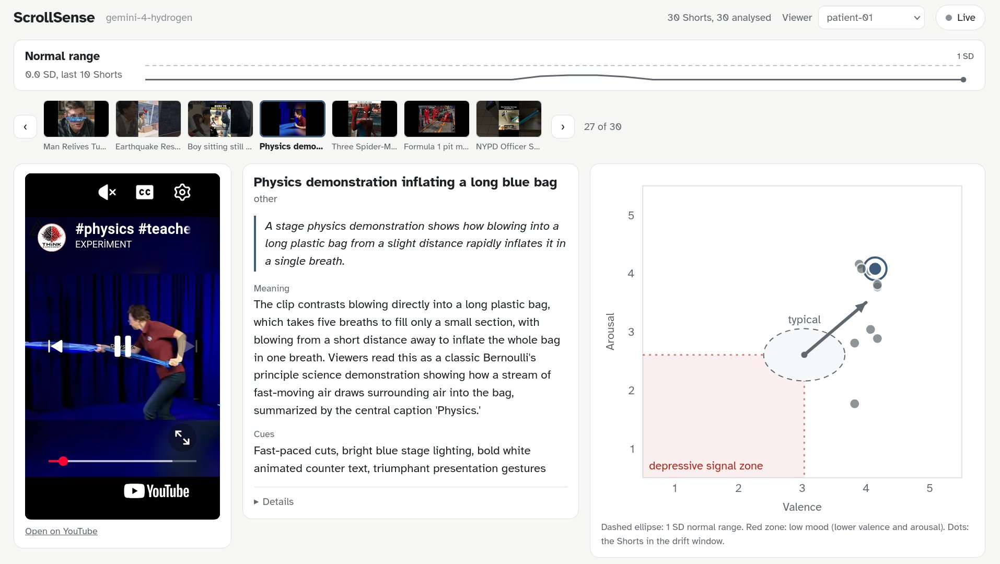

# ScrollSense

**Your short-form feed knows when you're spiralling before you do.**  
Built at Junction 2026. A gentle check-in and analytics tool for YouTube Shorts, helping people recovering from depression catch early signs of a setback.



*Research prototype, not a medical device. Scores describe the content, not the person, and **are not a diagnosis**.*

---

## The problem

Short-form content algorithms are predatory: they optimize for watch time, not wellbeing. When you linger on a few heavy or melancholic clips, the feed locks onto that signal and quietly pulls you into a low-mood loop that is hard to notice from the inside.

Current digital wellbeing tools miss this:
- Screen-time limits only count minutes, not what the feed is showing you.
- Manual mood trackers take daily effort and get abandoned.

## Turning the feed into a signal

Instead of fighting the algorithm, **ScrollSense uses it for good**, detecting when content turns depressing, gathering that signal passively, and issuing a gentle nudge when it notices a downward spiral:

- A small userscript on your phone logs only the public video ID and timestamp when a Short opens, with no personal data or account history collected.
- Gemini watches the Short and scores its emotional tone from its audio, visuals, and on-screen text.
- The dashboard separates what the software sees (live affect map and trend) from what a clinician sees (check-in history).
- When the feed stays in low-valence, low-arousal territory, your phone surfaces a calm check-in card (*"How do these videos feel right now?"*) with three equal choices: *I am okay*, *I want to take a break*, or *Not now*.
- Healthcare professionals can use the gathered drift trends and check-in history to monitor recovering patients and spot early signs of a setback.

<!-- Media slot: add a side-by-side GIF of scrolling Shorts + the Affect Map moving in real time -->
<!--  -->

---

## How it works

```text
Phone (YouTube Shorts + Violentmonkey)  ──►  POST /api/views (video ID, timestamp)
  │                                               │
  │                                               ▼
  │                                          Paced Queue ──► Gemini (video URL → meaning + affect scores)
  │                                                               │
  │                                                               ▼
  │                                                      Rolling Drift Engine (vs. global affect norm)
  │                                                               │
  ◄── Check-in card in receipt (if warning + cooldown) ◄──────────┤
                                                                  ▼
                                                    Laptop Dashboard (/ for phone, /demo/ for browser)
```

1. **Multimodal Gemini analysis (`scrollsense/gemini.py`, `service.py`):** Watches the Short directly and outputs structured meaning (`transcript`, `on_screen_text`, `emotional_cues`, `intended_meaning`) plus `ClipScores` (`valence` 1–5, `arousal` 1–5, `stance`, `hopeful`). Defaults to the fast `one_call` pipeline (`gemini-3.5-flash-lite`); `GEMINI_PIPELINE=two_stage` runs describe-then-score with `gemini-4-hydrogen`.
2. **Global-norm drift (`scrollsense/drift/`):** Compares the rolling window of analysed Shorts (default `5`, first views only) against a global affect norm (Warriner et al., 2013 mapped to 1–5: `valence 3.03 ± 0.64`, `arousal 2.61 ± 0.45`). Drifting `> 1 SD` into the bottom-left quadrant (low valence + low arousal) triggers a `warning`. See [docs/clinical-calibration.md](docs/clinical-calibration.md).
3. **Gentle check-in (`scrollsense/nudge.py`):** On a `warning` (default streak `1`), with cooldown (`900 s`) and quiet hours, the next `/api/views` receipt delivers a check-in card. Choosing *"I want to take a break"* pauses the video and closes/blanks the tab. See [docs/patient-nudge-plan.md](docs/patient-nudge-plan.md).

### Gemini API integration

ScrollSense relies on Gemini's native multimodal video capabilities rather than wrapping a text LLM:

- **Direct YouTube URL video understanding:** Using `google-genai`, Gemini watches public Shorts URLs directly with a configurable watch cap (`GEMINI_MAX_WATCH_S=30` via `video_metadata`), reading audio, visuals, pacing, and on-screen text together without downloading videos or running separate ASR/OCR pipelines.
- **Reasoning-before-score structured output:** Strict Pydantic schemas (`scrollsense/schemas.py`) require Gemini to extract concrete cues and intended meaning before outputting valence and arousal scores, feeding the rolling drift engine in real time (`~2–3 s` per Short with `one_call` on `gemini-3.5-flash-lite`, or `two_stage` with `gemini-4-hydrogen`).

<!-- Media slot: add a screenshot or GIF of the phone check-in card -->
<!--  -->

---

## Quick start

Requires Python **3.10+**, [`uv`](https://docs.astral.sh/uv/), and a paid-tier `GEMINI_API_KEY` (paid-tier prompts are not used to train Google's models).

```bash
uv sync
cp .env.example .env        # set GEMINI_API_KEY and SCROLLSENSE_TOKEN
uv run uvicorn scrollsense.server:app --reload --port 8765
```

Open **`http://localhost:8765/?token=<your-token>`** for the phone-connected product dashboard, or **`http://localhost:8765/demo/?token=<your-token>`** for the single-device browser demo (the page remembers your token).

- **No API key? Run in mock mode:**
  ```bash
  SCROLLSENSE_MOCK=1 uv run uvicorn scrollsense.server:app --reload --port 8765
  ```
- **Connect your phone:** Set `SCROLLSENSE_TOKEN` in `.env`, expose port `8765` over HTTPS with `cloudflared tunnel --url http://127.0.0.1:8765`, open `https://<tunnel>/scrollsense.user.js` in Violentmonkey (e.g. Firefox Android) to install [web/scrollsense.user.js](web/scrollsense.user.js), and enter your tunnel URL, token, and pseudonym when prompted on YouTube Shorts.
- **Live single-device demo:** Set `SCROLLSENSE_LIVE_INFERENCE=1 SCROLLSENSE_WORKERS=6` to run fresh Gemini analyses on every viewer's first watch at `/demo/`, or deploy to Modal with `scripts/deploy_modal.sh` (`modal_app.py`).

### Useful commands

```bash
uv run python -m scrollsense [--force] <url> [...]   # batch-analyse Shorts (cached in data/clips/)
uv run python -m scrollsense.drift test-patient      # print a text drift report
PYTHONPATH=. uv run python scripts/tune_drift.py     # evaluate drift rules on simulated feeds
uv run pytest                                        # run the test suite (118 tests)
```

---

## Technical reference

<details>
<summary><strong>Environment variables</strong> (<code>.env</code>)</summary>

| Variable | Default | Meaning |
|---|---|---|
| `GEMINI_API_KEY` | — | Gemini API key (required unless `SCROLLSENSE_MOCK=1`) |
| `GEMINI_PIPELINE` | `one_call` | `one_call` (~2–3 s) or `two_stage` (describe-then-score) |
| `GEMINI_MODEL` | `gemini-3.5-flash-lite` | Model (`gemini-4-hydrogen` default for `two_stage`) |
| `GEMINI_MAX_WATCH_S` | `30` | Seconds watched per Short (`0` = full video) |
| `SCROLLSENSE_TOKEN` | unset | Bearer token for all `/api/*` routes |
| `SCROLLSENSE_MOCK` | `0` | `1` uses placeholder analyses in `data/mock_clips/` |
| `SCROLLSENSE_LIVE_INFERENCE` | `0` | `1` runs fresh Gemini inference per viewer's first watch |
| `SCROLLSENSE_WORKERS` / `_RPM` | `2` / `20` | Worker concurrency and rate limit (`0` = unpaced) |
| `SCROLLSENSE_DRIFT_WINDOW` | `5` | Rolling window in analysed Shorts |
| `SCROLLSENSE_DRIFT_WATCH` / `_WARN` | `1.0` / `1.0` | Bottom-left SD thresholds (`≥ 1.0`) |
| `SCROLLSENSE_NUDGE_ENABLED` | `1` | `0` disables phone check-in cards |
| `SCROLLSENSE_NUDGE_STREAK` | `1` | Consecutive `warning` points before nudging |
| `SCROLLSENSE_NUDGE_COOLDOWN_S` / `_OK_FACTOR` | `900` / `1` | Cooldown in seconds and multiplier after *"I am okay"* |
| `SCROLLSENSE_NUDGE_EXPIRE_S` | `900` | Unanswered card expiry in seconds |
| `SCROLLSENSE_NUDGE_QUIET_FROM` / `_TO` | unset | Quiet hours (`0–23`, using `TZ_OFFSET_MIN=120`) |

</details>

<details>
<summary><strong>HTTP API</strong> (<code>Authorization: Bearer &lt;token&gt;</code> when token is set)</summary>

| Method & Path | Returns |
|---|---|
| `GET /api/meta` | `{analyser: {name, mock}, live}` |
| `GET /api/clips`, `GET /api/clips/{id}` | Clip summaries or one full analysis |
| `POST /api/views` | `202` `{accepted, duplicates, queued, rejected, nudge}` (only `surface: "shorts"` analysed) |
| `POST /api/demo/shorts` | `201` `{video_id, state}` (web demo URL paste route) |
| `GET /api/viewers` | `[{viewer, events, last_seen}]` |
| `GET /api/viewers/{v}/feed?limit=50` | Newest events with `state` and `clip` |
| `GET /api/viewers/{v}/drift` | Full drift report (`level`, `score`, `affect_baseline`, `timeline`, etc.) |
| `GET /api/viewers/{v}/nudges` | Nudge history with answer, `state`, and `cooldown_remaining_s` |
| `POST /api/viewers/{v}/nudges/{id}/response` | Records `{choice}` (`204`; `404`/`409`/`422` on errors) |
| `DELETE /api/viewers/{v}` | `204`; erases viewer views and nudges |
| `GET /api/queue` | `{depth, in_flight, done, failed, recent_failures}` |

</details>

<details>
<summary><strong>Project structure</strong></summary>

```text
scrollsense/
├── domain.py, views.py          # Pure values: VideoId, ClipAnalysis, ViewerId, ViewEvent
├── schemas.py, prompts.py       # Structured-output schemas & prompts (one_call / two_stage)
├── ports.py                     # Swappable interfaces (ContentAnalyser, AnalysisStore, Logs, Nudger)
├── gemini.py, mock.py           # Gemini and mock ContentAnalyser implementations
├── store.py, viewlog.py         # JSON and JSONL storage
├── service.py, analysis_queue.py, scheduling.py, intake.py  # Pipeline, queue, scheduler, intake
├── affect_norms.py              # Global affect norm loader (reference/affect_norms.json)
├── drift/                       # Pure drift math, levels, and text CLI
├── nudge.py, nudgelog.py, nudge_api.py       # Nudge policy, log, and routes
├── api.py, views_api.py, drift_api.py, demo_api.py, auth.py  # FastAPI routes and Bearer auth
└── composition.py, server.py, __main__.py    # Wiring and entry points

web/                             # Product dashboard (/), single-device demo (/demo/), phone userscript
modal_app.py                     # Modal ASGI deployment entrypoint for the web demo
docs/                            # Calibration notes and design plans
scripts/                         # Drift tuning, norm-building, demo feed, and Modal deploy scripts
tests/                           # Unit and API test suite
```

</details>

---

## Limitations

- **YouTube Shorts only:** Gemini reads public YouTube URLs directly (preview feature, up to 8 hours/day); private videos fail and platforms like TikTok are not supported.
- **Not clinically validated:** The affect norm is derived from English word ratings (Warriner et al., 2013), and thresholds are tuned on simulated feeds rather than clinical trials.

---

## License

[MIT](LICENSE) — © 2026 Roope Suoraniemi, Milko Roine, Onni Seppänen
